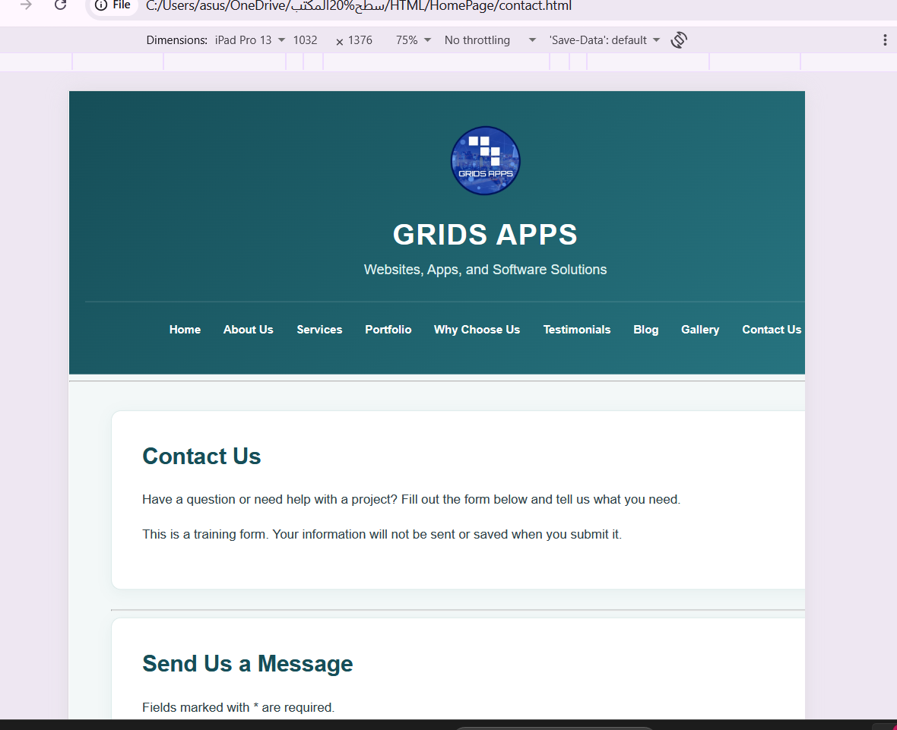
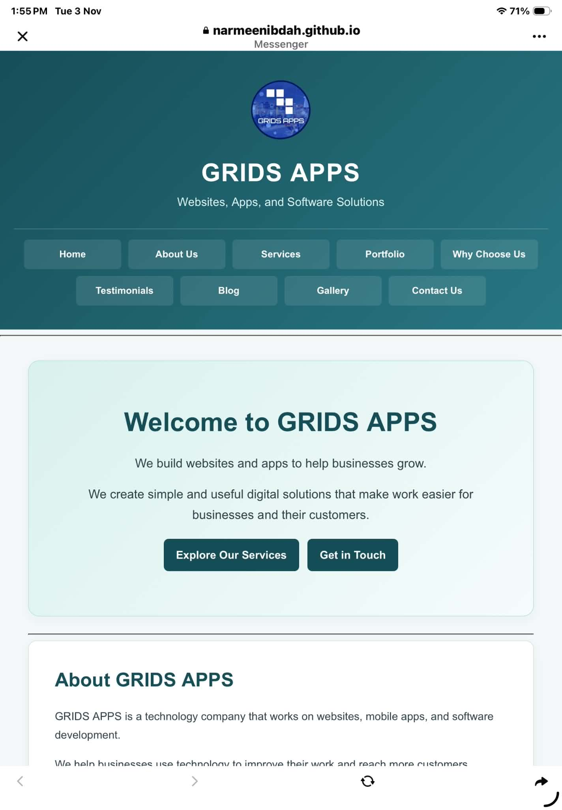

# Day 04 – Flexbox, Grid & Responsive Design

## Objective
Make the GRIDS APPS website responsive on mobile, tablet, and desktop screens.

## What I Completed
- Created a responsive navigation bar using Flexbox and CSS Grid.
- Used CSS Grid to organize the service cards.
- Added media queries for different screen sizes.
- Tested the website on mobile, tablet, and desktop.
- Checked for horizontal overflow and fixed responsive layout issues.

## Screenshots

### Desktop

### Tablet

### Mobile

## Flexbox vs Grid
I used Flexbox for the navigation bar because it helps arrange links and allows them to wrap when needed.

I used CSS Grid for the service cards because it makes it easier to organize them into columns and change the layout based on screen size.

## Challenges
One problem was that the navigation links did not appear correctly on mobile screens. I fixed this by updating the media queries and using a three-column grid for the mobile navigation.

## Result
The website now adjusts to different screen sizes, and the content is easier to read and navigate.